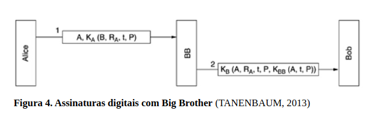
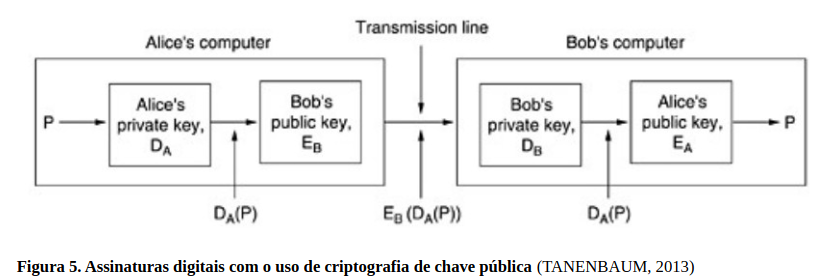
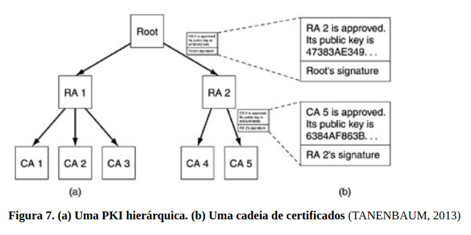

# Segurança de Redes

## Assinaturas Digitais

São uma tecnologia criada para substituir as assinaturas manuscritas em documentos eletrônicos, garantindo que uma mensagem ou documento digital seja autêntico, seguro e não possa ser falsificado.

No mundo físico, a assinatura em documentos legais e financeiros comprova a autoria e a validade de uma informação. Porém, em sistemas digitais, é necessário um mecanismo que garanta a mesma confiança sem depender de documentos em papel.

Uma assinatura digital deve garantir três requisitos principais:

* **Autenticidade:** permite que o receptor confirme a identidade de quem enviou a mensagem, garantindo que ela realmente veio da pessoa ou entidade informada.
* **Não repúdio:** impede que o remetente negue posteriormente que enviou ou assinou determinada mensagem. Isso protege as partes envolvidas em transações, evitando fraudes ou negações falsas.
* **Impossibilidade de falsificação pelo receptor:** garante que quem recebeu uma mensagem assinada não consiga criar outra mensagem falsa e atribuí-la ao remetente original.

Assim, as assinaturas digitais utilizam técnicas de criptografia, especialmente algoritmos de chave pública, para garantir a identidade das partes, a integridade das informações e a validade das transações eletrônicas.

### Assinaturas de chave simétrica

Utilizam uma autoridade central confiável, chamada de **Big Brother (BB)**, responsável por gerenciar as chaves secretas dos usuários. Cada participante possui uma chave secreta que é conhecida apenas por ele e pela autoridade central.

Quando Alice deseja enviar uma mensagem assinada para Bob, ela utiliza sua chave secreta KA para criptografar a mensagem, incluindo informações como:

A identidade do destinatário (Bob);
Um número aleatório (RA) para identificar a mensagem;
Um registro de tempo (t) para garantir que a mensagem seja recente;
O conteúdo da mensagem (P).

A autoridade central (BB) recebe a mensagem, verifica se ela realmente veio de Alice, descriptografa o conteúdo e então envia a Bob uma versão protegida com a chave secreta de Bob (KB), informando que a mensagem foi enviada por Alice.

Esse processo garante que:

Bob consiga verificar a identidade de Alice, pois somente ela e BB possuem a chave KA;
Alice não consiga negar o envio da mensagem, pois BB pode confirmar a origem da assinatura;
A mensagem não seja falsificada, pois terceiros não possuem as chaves secretas necessárias.

Caso Alice tente negar posteriormente que enviou a mensagem, Bob pode apresentar a prova digital gerada por BB, que confirma a autoria da comunicação.

Um problema desse método é o risco de repetição de mensagens antigas (replay attack), 
em que um invasor tenta reutilizar uma mensagem válida para realizar uma nova ação. 
Para evitar isso, são utilizados: Timbres de hora, que indicam quando a mensagem foi criada,
números aleatórios (RA), que permitem identificar mensagens já utilizadas

Assim, mensagens antigas ou repetidas podem ser identificadas e descartadas, aumentando a segurança do sistema.

### Sumário de Mensagens

são técnicas utilizadas para melhorar a eficiência das assinaturas digitais. 
Uma crítica aos métodos tradicionais de assinatura é que eles costumam juntar duas funções diferentes: 
autenticação e sigilo. 
Porém, na maioria dos casos, é necessário apenas garantir a autenticidade da mensagem, 
sem precisar criptografar todo o conteúdo.

Como a criptografia de mensagens completas pode ser lenta, utiliza-se uma função de hash unidirecional, 
que transforma uma mensagem de qualquer tamanho em uma sequência fixa de 
bits chamada sumário de mensagem (hash).

Uma função de hash possui quatro importantes propriedades:

1. Se P for fornecido, o cálculo de MD(P) será muito fácil.
2. Se MD(P) for fornecido, será efetivamente impossível encontrar P.
3. Dado P, ninguém pode encontrar P' tal que MD(P') = MD(P).
4. Uma mudança na entrada de até mesmo 1 bit produz uma saída muito diferente

Para atender ao critério 3, a função de hash deve ter pelo menos 128 bits, de preferência
mais. Para atender ao critério 4, o hash deve desfigurar completamente os bits, o que não é diferente
dos algoritmos de criptografia de chave simétrica que vimos.

O uso de sumários de mensagens torna as assinaturas digitais mais rápidas, pois em vez de criptografar toda a mensagem, o sistema assina apenas o seu hash. Dessa forma, é possível verificar a autenticidade sem precisar proteger todo o conteúdo.

No processo de assinatura, a autoridade ou o usuário calcula o hash da mensagem e assina digitalmente esse resultado. Caso alguém altere a mensagem durante a transmissão, o receptor pode recalcular o hash e comparar com o hash assinado. Se forem diferentes, significa que a mensagem foi modificada.

Os sumários de mensagens também são utilizados com criptografia de chave pública. Nesse modelo, Alice calcula o hash da mensagem, assina esse hash com sua chave privada e envia para Bob:

A mensagem original (P)
O hash assinado (Dₐ(MD(P))).

Bob recalcula o hash da mensagem recebida e verifica a assinatura. Caso um invasor altere o conteúdo, o valor do hash não será correspondente, revelando a tentativa de fraude.

Dois algoritmos históricos de sumário de mensagens são:

**MD5:** criado por Ronald Rivest, processa blocos de 512 bits e gera um hash de 128 bits. Atualmente não é recomendado para aplicações que exigem alta segurança devido a vulnerabilidades conhecidas.

**SHA-1 (Secure Hash Algorithm 1):** desenvolvido pela National Security Agency e aprovado pelo National Institute of Standards and Technology, gera um hash de 160 bits, mas também foi substituído por versões mais seguras.

## Gerenciamento de Chaves Públicas

O gerenciamento de chaves públicas é um dos principais desafios da criptografia de chave pública. 
O problema é garantir que uma chave pública realmente pertence à pessoa correta e 
não a um invasor que esteja tentando se passar por ela.

Por exemplo, se Bob obtiver a chave pública de Alice por um site, um atacante como Trudy 
poderia interceptar a comunicação e substituir a chave verdadeira pela sua própria chave pública. 
Dessa forma, Bob acreditaria estar se comunicando com Alice, mas na verdade estaria enviando informações para Trudy.

### Certificados

Para resolver esse problema foram criados os certificados digitais, que funcionam de maneira semelhante ao 
reconhecimento de uma assinatura em documentos físicos. 
Eles são emitidos por uma Autoridade Certificadora **(CA - Certification Authority)**, 
uma entidade confiável responsável por confirmar a identidade do proprietário de uma chave pública.

O processo funciona da seguinte forma:

* O usuário apresenta sua identidade para a Autoridade Certificadora
* A CA verifica essas informações e registra a chave pública do usuário
* A CA cria um certificado digital confirmando que aquela chave pertence àquela pessoa
* O certificado é assinado digitalmente pela CA usando sua chave privada.

O certificado contém um sumário de mensagem (hash) assinado pela autoridade certificadora, 
garantindo que ninguém consiga alterar suas informações sem ser detectado.

Os certificados não precisam ser secretos e podem ser disponibilizados publicamente, como em sites. 
Caso um invasor tente substituir um certificado verdadeiro por um falso, 
ele não conseguirá criar uma assinatura válida da CA, pois não possui a chave privada da autoridade certificadora.

Assim, os certificados digitais permitem que usuários confirmem a autenticidade das chaves públicas, evitando 
ataques de falsificação e garantindo uma comunicação segura entre pessoas que nunca tiveram contato anterior.

### Infraestrutura de Chave Pública (PKI - Public Key Infrastructure) 

Foi criada para resolver os problemas relacionados ao gerenciamento e à confiança das chaves públicas na Internet.

Uma única Autoridade Certificadora (CA) centralizada não seria uma solução adequada, 
pois teria dificuldades para atender todos os usuários da Internet, além de representar um grande risco. 
Se essa autoridade sofresse uma falha ou tivesse sua chave privada comprometida, 
toda a segurança baseada nela poderia ser afetada. 
Além disso, seria difícil encontrar uma única entidade em que todos os países e usuários confiassem.

A PKI utiliza uma estrutura hierárquica de autoridades certificadoras, formada por diferentes níveis de confiança:

**CA Raiz:** é a autoridade de maior nível e certifica outras autoridades.
**RA (Autoridade Regional):** recebe certificados da CA raiz e pode representar regiões, países ou continentes.
**CA (Autoridade Certificadora):** emite certificados digitais para pessoas, empresas e organizações.

Essa organização cria uma cadeia de certificados, também chamada de cadeia de confiança ou caminho 
de certificação. Nela, cada certificado é validado pela autoridade que o assinou, até chegar à CA raiz, 
que é considerada confiável.

Por exemplo, se Alice deseja confirmar a chave pública de Bob:

1. Alice recebe o certificado de Bob, assinado por uma CA
2. Ela verifica o certificado dessa CA
3. Caso não conheça essa CA, busca o certificado da autoridade superior
4. Continua esse processo até chegar à CA raiz
5. Se todos os certificados forem válidos, Alice confirma que a chave pública de Bob é verdadeira

Os navegadores e sistemas operacionais já possuem certificados de várias raízes confiáveis armazenados. 
Caso uma nova PKI não seja reconhecida, o usuário pode adicionar manualmente seu certificado raiz.

Como não existe uma única autoridade mundial, existem várias raízes independentes de PKIs. 
Um exemplo é a ICP-Brasil, uma infraestrutura de certificação digital administrada no Brasil, 
e outras autoridades privadas existentes em diferentes países.