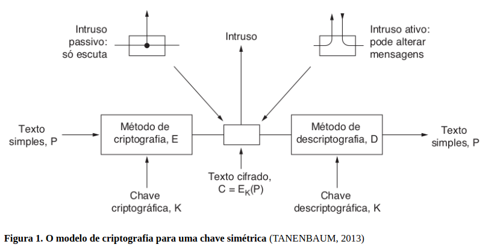
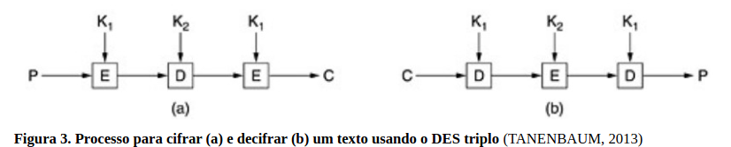

# Segurança de Redes

## Criptografia

A criptografia é uma técnica usada para proteger informações, transformando uma mensagem original em uma forma ilegível para pessoas não autorizadas. 
O termo vem do grego kryptós (secreto, oculto) e gráphein (escrita), significando “escrita secreta”. 
Seu uso existe há milhares de anos, principalmente em contextos militares, 
para proteger mensagens que poderiam ser interceptadas por inimigos.

Na criptografia, existe uma diferença entre cifra e código. 
A cifra altera os caracteres ou bits da mensagem seguindo um método matemático, 
enquanto o código substitui palavras ou símbolos por outros elementos. 
Atualmente, os sistemas de criptografia utilizam principalmente cifras.

Com o tempo, percebeu-se que manter o método de criptografia em segredo não era eficiente. 
Por isso, surgiram métodos baseados no uso de chaves criptográficas, 
nas quais o algoritmo pode ser conhecido publicamente, mas a chave permanece secreta. 
Assim, mesmo que alguém conheça o método utilizado, não conseguirá acessar a mensagem sem possuir a chave correta.

O funcionamento básico da criptografia envolve três elementos:

* Texto simples **(plaintext - P):** mensagem original;
* Texto cifrado **(ciphertext - C):** mensagem transformada e protegida;
* Chave criptográfica **(K):** informação usada para cifrar e decifrar a mensagem.

O processo de criptografia transforma o texto simples em texto cifrado usando um método de cifragem (E) e uma chave (K):
**C = Eₖ(P)**
Para recuperar a mensagem original, utiliza-se o método de decifragem (D) com a mesma chave:
**P = Dₖ(C)**

Durante a transmissão, a mensagem pode ser interceptada por invasores. 
Eles podem ser **passivos**, apenas observando a comunicação, ou **ativos,** 
tentando modificar os dados. Sem a chave correta, a recuperação da mensagem é extremamente difícil.

A área que estuda a criação de mensagens protegidas é chamada de **criptografia**, 
enquanto a tentativa de quebrar esses sistemas é chamada de criptoanálise. 
O estudo conjunto dessas duas áreas recebe o nome de **criptologia**.

Atualmente, os sistemas seguem o **Princípio de Kerckhoff**, que afirma que os algoritmos de criptografia
devem ser públicos e apenas as chaves devem permanecer secretas. 
Isso permite que especialistas testem os algoritmos e encontrem possíveis falhas, tornando os sistemas mais seguros.

A segurança da criptografia depende principalmente de: Um algoritmo forte e confiável, 
uma chave suficientemente longa e secreta.

Quanto maior o tamanho da chave, maior o número de possibilidades que um invasor teria que testar para descobrir a chave. 
Por exemplo, chaves pequenas podem ser quebradas mais facilmente, 
enquanto chaves maiores oferecem maior proteção. 
Em geral, chaves de 64 bits podem ser usadas para situações simples, 
128 bits para transações comerciais e 256 bits para informações de alta importância, como comunicações militares

### Cifras de Substituição

São métodos criptográficos em que cada letra ou grupo de letras de uma mensagem original 
é substituído por outro símbolo ou letra, criando um texto cifrado. 
O objetivo é dificultar a compreensão da mensagem por pessoas não autorizadas.

Um dos exemplos mais antigos é a **Cifra de César**, criada e utilizada por Júlio César. 
Nessa técnica, cada letra do alfabeto é **deslocada por um determinado número de posições**. 
No caso mais conhecido, o deslocamento é de 3 posições (K=3): a torna-se D, b torna-se E,
c torna-se F, e assim por diante. 

Dessa forma, a palavra **"ataque" é transformada em "DWDTXH"**. 

Porém, como existem apenas 25 possibilidades de deslocamento em um alfabeto de 26 letras, 
esse método é considerado muito fraco atualmente.

Outro método é a **substituição monoalfabética**, em que cada letra do alfabeto 
é trocada sempre pela mesma outra letra. 
Apesar de possuir um número muito grande de **possibilidades de chaves (26! combinações)**, 
esse método pode ser quebrado por meio da análise de frequência.

Texto simples: a b c d e f g h i j k l m n o p q r s t u v w x y z

Texto cifrado: Q W E R T Y U I O P A S D F G H J K L Z X C V B N M

Por essa técnica, a palavra **"ataque" é cifrada como "QZQHXT"**

A análise de frequência consiste em observar quais letras aparecem com maior frequência 
no texto cifrado e compará-las com a frequência das letras em determinado idioma. 
No português, por exemplo, as letras a, e e o são algumas das mais comuns. Além disso, 
também podem ser analisadas combinações frequentes de letras, como "ch", "lh" e "ss", 
ou grupos de três letras, ajudando a descobrir gradualmente o texto original.

Apesar do grande número de possibilidades, a **substituição monoalfabética** não é considerada segura porque apresenta padrões que podem ser identificados por técnicas de criptoanálise.

Para aumentar a segurança, foram criadas as cifras de **substituição polialfabética**, 
que utilizam vários alfabetos diferentes para substituir as letras da mensagem.
Isso dificulta a análise de frequência, pois a mesma letra pode ser substituída por símbolos diferentes dependendo da posição na mensagem. 
Entretanto, mesmo essas técnicas podem ser quebradas com métodos de análise mais avançados.

### Cifras de Transposição

São métodos de criptografia que, diferente das cifras de substituição, não alteram os símbolos da mensagem, 
mas **apenas modificam a ordem em que eles aparecem**. 
Ou seja, as letras permanecem iguais, porém são reorganizadas seguindo uma regra definida.

Um exemplo desse método utiliza uma palavra-chave sem letras repetidas para determinar a ordem de reorganização dos caracteres. 
A palavra-chave é organizada em ordem alfabética, 
criando uma sequência numérica que indica a ordem das colunas de uma matriz. 
O texto original é então dividido em blocos do tamanho da chave, 
colocado nessa matriz e lido seguindo a sequência definida, formando o texto cifrado.

Por exemplo, usando a chave PERNAMBUCO, as letras da palavra são ordenadas alfabeticamente para gerar uma sequência de leitura das colunas. O resultado é uma mensagem embaralhada, mas contendo exatamente as mesmas letras do texto original.

As letras em ordem alfabética são **ABCEMNOPRU** e a sequência será **8-4-9-6-1-5-2-10-3-7**.

**Texto simples:** favor transferir um milhão de dólares para minha conta nas ilhas caymã

| P | E | R | N | A | M | B | U  | C | O |
|---|---|---|---|---|---|---|----|---|---|
| 8 | 4 | 9 | 6 | 1 | 5 | 2 | 10 | 3 | 7 | 
| f | a | v | o | r |   | t | r  | a | n |
| s | f | e | r | i | r |   | u  | m |   |
| m | i | l | h | ã | o |   | d  | e |   |
| d | ó | l | a | r | e | s |    | p | a |
| r | a |   | m | i | n | h | a  |   | c |
| o | n | t | a |   | n | a | s  |   | i |
| l | h | a | s |   | c | a | y  | m | ã |

**Texto cifrado:** RIÃRI T SHAAAMEP MAFIÓANH ROENNCORHAMASN ACIÃFSMDROLVELL TARUD ASY

Apesar de parecer mais seguro, esse tipo de cifra também possui vulnerabilidades. 
Como as letras não são substituídas, a frequência dos símbolos permanece **igual à do idioma original**. 
Assim, técnicas de **análise de frequência** podem identificar que a mensagem foi transposta, 
além de ajudar a descobrir o tamanho da chave e a ordem correta das colunas.

Para quebrar uma cifra de transposição, os analistas podem observar:
a frequência das letras do texto cifrado, o tamanho provável da chave,
a distância entre combinações comuns de letras, como "ch", "lh", "ss" e "ção",
diferentes tentativas de reorganização das colunas até que palavras e frases com sentido sejam encontradas.

### Cifra de Chave Única

Também chamada de **cifra de uso único ou One-Time Pad**, é um método criptográfico considerado perfeito em teoria, pois uma mensagem cifrada corretamente não pode ser quebrada por técnicas de criptoanálise.

Esse método utiliza uma sequência de bits aleatórios, chamada de chave, que deve possuir tamanho igual ou maior que o tamanho da mensagem. A criptografia é feita aplicando a operação lógica XOR (ou exclusivo) entre os bits da mensagem original e os bits da chave.

A operação XOR funciona da seguinte forma:

* 0 XOR 0 = 0
* 0 XOR 1 = 1
* 1 XOR 0 = 1
* 1 XOR 1 = 0

Com isso, os bits 1 da chave alteram os bits correspondentes da mensagem, 
enquanto os bits 0 mantêm o valor original. 
Como a chave é totalmente aleatória e não se repete, não existe um padrão que possa 
ser analisado para descobrir a mensagem original.

A principal vantagem desse método é que, sem conhecer a chave correta, 
qualquer mensagem poderia ser obtida a partir de um texto cifrado. 
Porém, na prática, ele apresenta uma grande dificuldade: a chave precisa ser tão grande quanto a mensagem,
deve ser compartilhada previamente entre remetente e destinatário e nunca pode ser reutilizada.

Por esse motivo, seu uso é limitado a situações específicas, como comunicações militares, onde uma chave pode ser entregue fisicamente aos envolvidos antes da transmissão das mensagens.

### Algoritmos de Chave Simétrica

são métodos de criptografia que utilizam a **mesma chave tanto para cifrar quanto para decifrar** uma mensagem. 
Isso significa que o remetente e o destinatário precisam possuir **previamente a mesma chave secreta** para realizar a comunicação segura.

As cifras de substituição e transposição são exemplos de algoritmos de chave simétrica. Entre os algoritmos mais conhecidos estão o DES (Data Encryption Standard) e o AES (Advanced Encryption Standard).

#### DES (Data Encryption Standard)

O DES foi desenvolvido pela IBM e adotado em 1977 pelo governo dos Estados Unidos como padrão de criptografia para dados não sigilosos. 
Originalmente, possuía uma **chave de 128 bits**, mas ela foi reduzida para **56 bits** durante o processo de padronização.

O DES funciona como uma **cifra de bloco**, dividindo a mensagem em **blocos de 64 bits** e transformando cada bloco em outro bloco de 64 bits usando uma chave de 56 bits. Apesar de ter sido muito utilizado em sistemas computacionais, atualmente o DES não é considerado seguro, pois sua chave é pequena e pode ser descoberta por ataques de força bruta.

***DES Triplo (3DES)***

Para aumentar a segurança do DES, foi criado o DES triplo, que aplica o algoritmo **três vezes consecutivas** utilizando duas chaves diferentes (K1 e K2).

O processo é:
* Cifrar a mensagem usando a chave K1.
* Decifrar usando a chave K2.
* Cifrar novamente usando a chave K1.

Essa técnica aumenta a segurança em relação ao DES original e também mantém compatibilidade com sistemas antigos. Porém, com o avanço da tecnologia, o 3DES também foi substituído por métodos mais modernos.

#### AES (Advanced Encryption Standard)

O AES foi criado para substituir o DES devido às limitações de segurança desse algoritmo. O processo de escolha do AES foi realizado pelo NIST (National Institute of Standards and Technology) por meio de um concurso público internacional, no qual diversos especialistas analisaram e testaram os algoritmos participantes.

As regras eram as seguintes:
1. O algoritmo teria que ser uma cifra de bloco simétrica.
2. Todo o projeto teria que ser público.
3. Deveriam ser admitidos tamanhos de chaves iguais a 128, 192 e 256 bits.
4. Teriam que ser possíveis implementações de software e de hardware.
5. O algoritmo teria que ser público ou licenciado em termos não discriminatórios.

O algoritmo escolhido foi o Rijndael, desenvolvido pelos criptógrafos belgas Joan Daemen e Vincent Rijmen. O AES tornou-se padrão em 2001 devido à sua segurança, eficiência e transparência no processo de seleção.

O AES utiliza: Blocos de dados de 128 bits, chaves de 128, 192 ou 256 bits.

Na prática, as versões mais utilizadas são:

* AES com bloco e chave de 128 bits;
* AES com bloco de 128 bits e chave de 256 bits.

Uma chave AES de 128 bits possui aproximadamente 3 × 10³⁸ possibilidades, tornando inviável testar todas as combinações por força bruta com a tecnologia atual. Caso seja necessário um nível ainda maior de segurança, pode-se utilizar uma chave de 256 bits.

Dessa forma, o AES tornou-se o principal padrão moderno de criptografia simétrica, oferecendo alta segurança para proteção de dados em sistemas computacionais e redes.

### Algoritmos de Chave Pública

Surgiram para resolver um dos maiores problemas da criptografia tradicional: a distribuição segura das chaves. 
Nos sistemas de chave simétrica, a mesma chave usada para cifrar e decifrar a mensagem precisa ser
compartilhada entre os usuários, o que cria o risco de ela ser roubada ou interceptada.

Em 1976, os pesquisadores Whitfield Diffie e Martin Hellman propuseram um novo modelo de criptografia 
em que as chaves de cifragem e decifragem são diferentes. Nesse sistema, cada usuário possui um par de chaves:

* **Chave pública:** pode ser divulgada para qualquer pessoa e é usada para criptografar mensagens destinadas ao proprietário.
* **Chave privada:** deve ser mantida em segredo e é usada para decifrar as mensagens recebidas.

Em sua proposta, o algoritmo de criptografia (com chave) E e o algoritmo de
descriptografia (com chave) D tinham de atender a três requisitos, 
que podem ser declarados da seguinte forma:
1. D(E(P)) = P.
2. É extremamente difícil deduzir D a partir de E.
3. E não pode ser decifrado por um ataque de texto simples escolhido.

O funcionamento ocorre da seguinte forma: uma pessoa, como Alice, cria seu par de chaves e divulga sua chave pública. Quando Bob deseja enviar uma mensagem secreta para Alice, ele utiliza a chave pública dela para criptografar o conteúdo. Apenas Alice, usando sua chave privada, consegue decifrar a mensagem. O mesmo processo ocorre quando Alice deseja enviar uma mensagem para Bob.

A principal diferença em relação à criptografia simétrica é que a chave pública pode ser compartilhada livremente, enquanto a chave privada permanece protegida.

#### RSA

Um dos algoritmos de chave pública mais conhecidos é o RSA, criado em 1978 por Ronald Rivest, 
Adi Shamir e Leonard Adleman, pesquisadores do Massachusetts Institute of Technology.

A segurança do RSA é baseada na dificuldade de fatorar números muito grandes, 
especialmente encontrar os números primos que deram origem à chave. O usuário gera duas chaves:

* Uma chave pública, que pode ser divulgada
* Uma chave privada, que deve permanecer secreta.

No RSA, uma mensagem criptografada com a chave pública só pode ser decifrada com a chave privada, e o processo inverso também funciona.

Apesar de ser considerado seguro, o RSA possui a desvantagem de ser mais lento que os algoritmos simétricos,
pois utiliza chaves muito grandes (geralmente a partir de 1024 bits, mais de 300 dígitos decimais). 
Por isso, normalmente ele é usado apenas para proteger a troca inicial de chaves em uma comunicação.

Após a troca segura da chave, os sistemas geralmente utilizam algoritmos de chave simétrica, que são mais rápidos e eficientes para criptografar grandes volumes de dados durante uma sessão de comunicação.